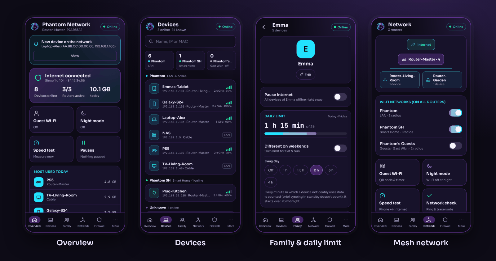
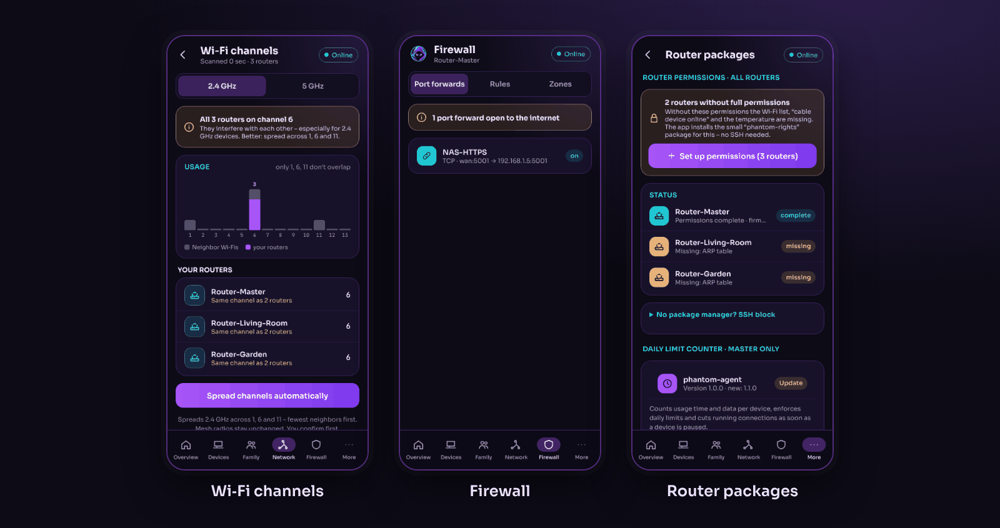
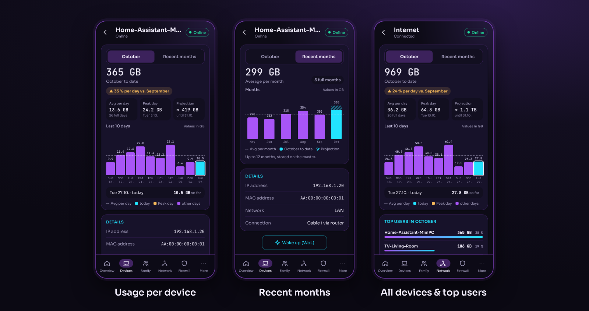

# Phantom Network

Android app to manage OpenWrt mesh routers – devices, family profiles with pauses, schedules and daily limits, Wi‑Fi, VPN and firewall. Local only, no cloud.

The app talks directly to your routers through the same interface the OpenWrt web interface (LuCI) uses: ubus JSON‑RPC via `rpcd`. There is no server, no account and no analytics. The UI is available in German and English.

> Built and tested on Cudy routers (WR3000E / WR3000P) running OpenWrt 25.12 – one router as master, the others as mesh access points. Other OpenWrt routers should work as long as they run OpenWrt 25.12 with LuCI.







## Features

- **Overview** – internet status, devices online, today's data usage, recent events
- **Devices** – grouped by network (any number of networks and VLANs, each with its own tile and color); rename, set the device type, pause internet (30 min, 1 h, until 7 am or any custom duration / time of day), prioritize, fixed IP, data per day and month
- **Data usage** – per device and for all devices: total this month, change per day vs. last month, average per day, peak day and projection to month end; the last 10 days with the exact value on every bar, recent months with average line, top users of the month
- **Family** – group devices into profiles; pause a whole profile, bedtime/homework schedules, daily time limit with weekend limit and one‑tap bonus time
- **Network** – mesh map, Wi‑Fi networks on all routers, guest Wi‑Fi with QR code and timer, night mode, speed test, ping/traceroute, Wi‑Fi channel scan and automatic channel planning
- **Firewall** – read‑only view of port forwards, rules and zones
- **Routers** – system info, ports, firmware update check (newer release in the same OpenWrt branch), backups to a folder of your choice, restart
- **Router packages** – install or remove the permission package (per router or on all at once) and the daily limit counter, no SSH needed
- **Device log** – connections, roaming between routers and bands, new devices and IP assignments from all routers
- **VPN** – WireGuard server on the master: create phone access with QR code, switch the tunnel on this phone
- **Notifications** – background check about every 15 minutes (over plain HTTP only on Wi‑Fi, LAN or VPN, never over mobile data): new devices, errors, routers offline, firmware updates, daily limit reached (with “+30 min” action)
- **Security** – HTTPS by default with certificate pinning on first use, optional app login with password and fingerprint

## Installation

1. Download the latest `PhantomNetwork-*.apk` from [Releases](../../releases).
2. Open it on your Android phone and allow installing apps from this source.
3. Start the app – it finds the master router on your Wi‑Fi by itself; sign in with the router's root password.

## How it works

| Part | Where it runs | What it does |
|---|---|---|
| `app/` | Android phone | Capacitor app (plain HTML/CSS/JS, no framework) plus a small native plugin for HTTPS pinning, notifications, fingerprint and backups |
| `rights/` | every router | `phantom-rights` package: only the rpcd permission file the app needs |
| `agent/` | master router | optional `phantom-agent` package (ucode service): counts usage time and data per device for daily limits and usage statistics, and cuts running connections when a device gets blocked |

Profiles, pauses, schedules and limits are stored as normal firewall rules in the router's UCI configuration, so every phone with the app sees the same state. The agent package ships inside the app and is installed with one tap (Family → profile → set up daily limit).

### Router requirements

- OpenWrt 25.12 with LuCI (`rpcd`, `uhttpd`); `luci-ssl` for HTTPS
- The app signs in as `root`. On stock OpenWrt some ubus calls are not allowed for `root` over RPC. The app installs the small `phantom-rights` package (one ACL file) on every router with one tap (More → Router packages) – no SSH needed. For routers without a package manager there is an equivalent SSH snippet.
- Optional: the `phantom-agent` package on the master (installed from within the app) for daily limits and usage statistics. It also cuts running connections when a device gets paused – without it, a pause only affects new connections.

## Project layout

```
docs/screenshots/   screenshots for this README (demo data)
app/                Capacitor project
  www/              the app itself (index.html, js/, css/, fonts, agent package)
  android/          Android project incl. native plugin (de.phantomnetwork.app)
agent/              phantom-agent package for the master router
rights/             phantom-rights package (router permissions)
build.sh            APK build script (runs inside the container)
docker-compose.yml  build container
```

Code comments are mostly in German.

## Privacy

The app only talks to your own routers, the router in front of them (UPnP status, home network only) and `downloads.openwrt.org` (public list of OpenWrt versions for the update check). Router passwords are stored encrypted in the Android keystore.

## Disclaimer

Private, non‑commercial project, provided without warranty. OpenWrt is a trademark of the OpenWrt project; Cudy and FRITZ!Box are trademarks of their respective owners. This project is not affiliated with them.

## Support

Phantom Network is a free hobby project. If it is useful to you, you can buy me a coffee via [PayPal](https://paypal.me/23Phantom08) – thank you!

## License

Copyright © 2026 Phantom

This program is free software: you can redistribute it and/or modify it under the terms of the GNU General Public License as published by the Free Software Foundation, either version 3 of the License, or (at your option) any later version. See [`LICENSE`](LICENSE).

Third‑party components (Capacitor, AndroidX, qrcode‑generator, Sora and JetBrains Mono fonts, …) keep their own licenses; they are listed in the app under About → Open source licenses.

Contact: phantoms.fritzbox@gmail.com
